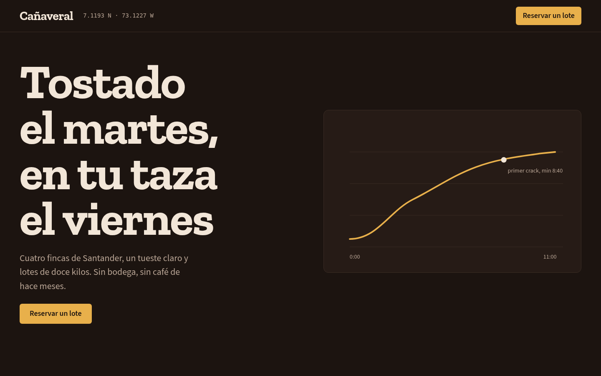
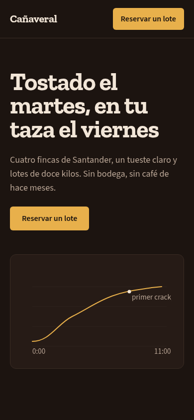

# frontend-craft

Agent skills that make any coding model build web pages that do not look generated: in any framework, from the shortest prompt, with a browser check that will not let the agent stop while the page is broken.

Ask a model for "a landing page for a coffee shop" and most of them return the same page: cream background, a serif headline with one italic word, a terracotta accent, tracked monospace labels, three equal cards, and almost no motion. Longer prompts do not fix this, because the model falls back to its defaults whenever a decision is left open. frontend-craft closes those decisions with three things a model can follow mechanically:

1. **A deal, not a taste call.** `start.mjs` picks the palette, type pairing, page composition and motion from a curated library, weighted by the brief's mood, skipping what recent builds used. Two coffee shops built a week apart get different pages.
2. **A kit, not a description of animation.** A dependency-free motion runtime driven by data attributes (word reveals, scroll-lit text, stacking cards, pinned rails, scrub, count-up, marquee, magnetic buttons), plus design tokens. It works the same in plain HTML, React, Next.js, Vue, Svelte and Astro.
3. **A gate, not a self-assessment.** `check.mjs` renders the page in headless Chrome at four widths, with reduced motion and with JavaScript off, and fails on what a visitor would hit: horizontal scroll, unreadable contrast, invisible content, console errors, missing fonts, no entrance, no scroll story, placeholder copy, and the generated-default look itself. In Claude Code the gate runs as a Stop hook; in other harnesses the agent runs it and does not finish while it exits 1.

```
brief ──> start.mjs ──> deal + tokens.css + kit + brief.md
                              │
                    agent builds the page with the kit
                              │
          check.mjs (Chrome: 1440/1280/768/390, reduced motion, no JS)
                              │
                FAIL ──> fix list back to the agent ──┐
                PASS ──> report with screenshots      │
                              ^───────────────────────┘
```

## Example

[`examples/roastery/`](examples/roastery/) is a coffee roastery page built by the run itself: dealt with `start.mjs --pin palette=espresso-honey,type=zilla-source,composition=index-list,signature=scroll-words`, built with the kit, and passed through `check.mjs` (its two failures along the way, a 21 px tall logo link and SVG chart labels rendering at 7.5 px on phones, were caught by the check and fixed).

<p>
  
  
</p>

Serve the folder (`npx serve examples/roastery`) to see the motion: words blur in, the origins list staggers, the manifesto lights word by word while pinned, the coordinates scramble, the action buttons lean toward the cursor.

## Skills

| Skill | Job |
|---|---|
| [`frontend-craft`](skills/frontend-craft/SKILL.md) | Build or redesign a page or site: deal, build with the kit, pass the check. Holds the kit, library and scripts. |
| [`craft-motion`](skills/craft-motion/SKILL.md) | Add, fix or trim motion in an interface that already exists. |
| [`craft-review`](skills/craft-review/SKILL.md) | Strict rendered review: findings as Before, After, Why with exact values. Does not edit. |
| [`craft-learn`](skills/craft-learn/SKILL.md) | Turn a session's design corrections into testable rules in `DESIGN.md`. |
| [`svg-craft`](skills/svg-craft/SKILL.md) | Icons, logos, illustrations, diagrams and animated SVG, with a render-and-look loop. |

The satellites call scripts in `frontend-craft`, so install them together.

## Install

Requirements: Node 22 or later and Chrome, Chromium or Edge (Playwright's Chromium also works; set `CHROME_PATH` for anything else).

**Claude Code (plugin).** The Stop-hook gate comes with it, plus a prompt hook that points web-page requests at the run so the skill fires even when other design skills compete.

```sh
/plugin marketplace add nicolas2601/frontend-craft
/plugin install frontend-craft@frontend-craft
```

**Any agent that reads Agent Skills** (Claude Code, Codex, Cursor, OpenCode, Gemini CLI, and others):

```sh
npx skills@latest add nicolas2601/frontend-craft
```

**By hand.** Copy or symlink each folder in `skills/` into your agent's skills directory (`~/.claude/skills/`, `~/.agents/skills/`, `~/.config/opencode/skills/`, or `.agents/skills/` in a project).

**OpenCode gate.** OpenCode has no Stop hook. Copy [`integrations/opencode/frontend-craft-gate.js`](integrations/opencode/frontend-craft-gate.js) to `~/.config/opencode/plugins/` (OpenCode loads that folder by itself; plugin API v2): when a session goes idle with a failing build, the fix list is sent back into the session. An optional `frontend` agent is in [`integrations/opencode/agents/frontend.md`](integrations/opencode/agents/frontend.md).

Details per harness: [docs/installation.md](docs/installation.md).

## Use

Ask in plain words. The skill supplies the design decisions.

> haz una landing page para una cafetería en Bucaramanga
>
> make a site for an indie music festival in Medellín, use Vue
>
> this page looks generic, fix it
>
> review localhost:5173 strictly

What the agent does, in order:

```sh
node <skill>/scripts/start.mjs --kind landing --moods warm,craft,coffee   # deal, copy the kit, print the brief
# ...build the page with the dealt tokens, composition and kit attributes...
node <skill>/scripts/start.mjs --url http://localhost:5173                # point the gate at the running page
node <skill>/scripts/check.mjs                                            # until RESULT: PASS
```

Useful flags: `--redeal` (a new hand), `--pin palette=pine-brass,type=geist-solo` (keep what the user approved), `--brand` (the project already has colors and fonts), `--kit-only` (existing UI, motion only), `--list` (every kind, mood and library id).

## The kit

```html
<h1 class="craft-display" data-words>Roasted on Tuesday, in your cup by Friday</h1>
<a class="cta" href="#order" data-enter data-magnetic data-press>Reserve this week's batch</a>

<section data-pin>
  <div><p data-scroll-words="pinned">We buy from four farms we visit every harvest.</p></div>
</section>

<section data-stack><article>…</article><article>…</article><article>…</article></section>
<strong data-count>1.280</strong> bags shipped
```

```js
import { init } from './craft/craft-motion.js';
const cleanup = init(document); // React: useEffect(() => init(document), [])
```

Fifteen effects, one `requestAnimationFrame` loop, shared observers, no dependencies. Under `prefers-reduced-motion` every effect shows its final state; without JavaScript all content stays visible; split text keeps one readable copy for screen readers; cleanup restores the DOM, so it is safe in React StrictMode and on route changes. Reference: [skills/frontend-craft/references/motion.md](skills/frontend-craft/references/motion.md). Framework wiring: [references/frameworks.md](skills/frontend-craft/references/frameworks.md).

## The library

| | Count | Notes |
|---|---|---|
| Palettes | 24 | Seven roles each; every text pair passes WCAG AA, enforced by tests |
| Type pairings | 24 | 41 Google Fonts families (OFL), each checked to exist; `<link>` and `next/font` setup generated |
| Compositions | 14 | What the first screen shows and how sections are paced (poster headline, split stage, index list, pinned rail, stacked chapters, specimen sheet, ...) |
| Motion signatures | 14 | Each mapped to kit attributes and a job |

The deal never pairs a cream ground with a serif display face, always includes a scroll story on persuasion pages, and avoids the last six choices recorded in `~/.local/state/frontend-craft/history.json`.

## The check

About thirty rules over facts measured in the rendered page. FAIL blocks, WARN advises; every finding names the element and the fix. The full catalogue is in [references/checks.md](skills/frontend-craft/references/checks.md). It also writes screenshots (`1440-early.png`, `1440.png`, `390.png` and tiles down the page) for the agent and the user to look at, because no script can judge taste.

## Evals

`evals/cases.json` holds deliberately short prompts. `node scripts/eval.mjs --case <id>` runs one through a real agent CLI (OpenCode by default, any model with `--model`), then loops the gate's FAIL list back into the same session up to three times, the same loop a Stop hook gives Claude Code, and writes the result to `evals/results/`. Results so far: [docs/evals.md](docs/evals.md).

## Develop

```sh
npm test          # unit tests, library contrast tests and the end-to-end check in Chrome
npm run verify    # skill structure: frontmatter, word budgets, links, vocabulary in sync with the library
npm run pack      # dist/<skill>.skill zip files
```

Layout: `skills/` (what gets installed), `tests/` (node:test, fixtures), `scripts/` (repo tooling: verify, eval, pack), `evals/`, `integrations/` (harness glue), `docs/`, `tools/opencode-observer/` (optional MCP server for inspecting OpenCode runs), `archive/v1/` (the previous version, kept for reference).

## Credits

Ideas adapted, not copied, from MIT-licensed work: dealing from a library with history and a finish gate as a Stop hook from [taste-skill](https://github.com/leonxlnx/taste-skill) (Leonxlnx); motion rules and the Before/After/Why review format from [emilkowalski/skills](https://github.com/emilkowalski/skills) (Emil Kowalski); the writing discipline for agent-facing documents from [mattpocock/skills](https://github.com/mattpocock/skills) (Matt Pocock). `svg-craft` vendors MIT packs listed in `skills/svg-craft/packs/*/LICENSE-*`. The archived v1 includes MIT recipes from MotionSites with their notice.

## License

MIT, see [LICENSE](LICENSE). Vendored packs keep their own MIT notices.
