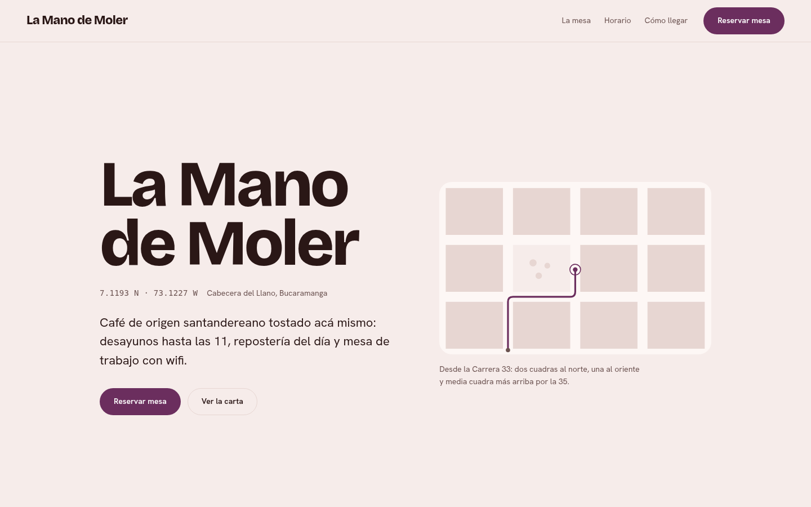

# Evals

Each case is a deliberately short prompt in `evals/cases.json`. `node scripts/eval.mjs --case <id>` runs it through a real agent CLI in a fresh folder, scores the result with `check.mjs`, and sends the FAIL list back into the same session up to three times. A case passes when the gate passes and the agent followed its deal. The screenshots are part of the result: the check measures defects, not taste.

## 2026-11-13: cafe-bucaramanga, DeepSeek V4.1 Flash in OpenCode 2.2.7

Prompt: `haz una landing page para una cafetería en Bucaramanga` (nothing else).

The same model, prompt and harness had produced, with frontend-craft v1, a single HTML file with a cream background, a serif headline with one italic red word, tracked mono labels, almost no motion, and a "done" report.

With v2:

| | Result |
|---|---|
| Followed the skill | Ran `start.mjs`, built with the kit, ran `check.mjs`, fixed what it reported (rendered SVG text under 12 px) and re-ran it before stopping |
| Stack chosen | Vite 8 + React + TypeScript, typecheck and build clean |
| Dealt direction | palette `clay-plum`, type `bricolage-hanken`, composition `place-coordinates`, signature `scramble` with `mask` and `scrub` |
| Followed the deal | Yes: dealt fonts and colors, coordinates and a drawn route on the first screen, hours and address as a ledger |
| Motion measured | 7 elements animate in on load; 10 scroll-linked (the route draws itself with `var(--p)`); 8 reveals |
| Gate | `RESULT: PASS` in the first round, 1 WARN (`nojs-empty`: client-only render) |
| Copy | Spanish, local and specific: "Caldo de costilla, arepa de maíz pelao, huevos pericos y tinto"; actions "Reservar mesa", "Ver la carta" |

<p>
  
  
</p>

Human review of the screenshots: coherent, readable, specific and clearly not the generated default. Weaker points the check cannot judge: the map is a plain grid of blocks rather than a finished illustration, and there is a large empty band under the menu. The visual ambition is "competent editorial", not exceptional; better first-screen artwork (for example through `svg-craft`) is the next lever.

### What the run exposed in the skill (fixed the same day)

- The agent created the project in `~/work/` instead of the session folder. The skill and the OpenCode agent now say: a new project goes in a new folder inside the current working directory.
- The check under-counted motion: its change threshold was in pixels, so `--p` (0 to 1) and scale changes were invisible, and a sticky nav counted as a pinned scene. Thresholds now depend on magnitude, and a pinned scene must hold a stage at least half a screen tall. The first recorded score (0 scroll-linked) was re-measured with the fixed check (10 scroll-linked).
- A pinned motion signature outside the dealt composition's list was silently replaced. Pins now always win.

### Cost note

With this machine's OpenCode configuration every turn carries about 147,000 input tokens of tools and instructions before the task. Standalone runs do not record their usage in the shared session store, so the exact total for this case was not captured.

## Running more

```sh
node scripts/eval.mjs --case festival-vue
node scripts/eval.mjs --all --model <provider/model>
node scripts/eval.mjs --case sushi-svelte --agent-cmd "opencode run --standalone --agent frontend --auto --format json"
```

Results are written to `evals/results/<date>-<case>.json` with the deal, the FAIL and WARN ids per round, the motion counts and the screenshot paths.
