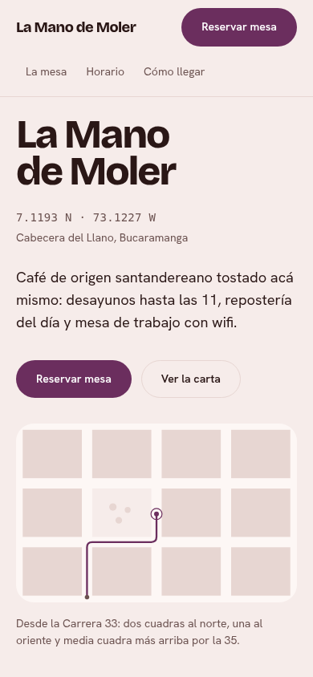
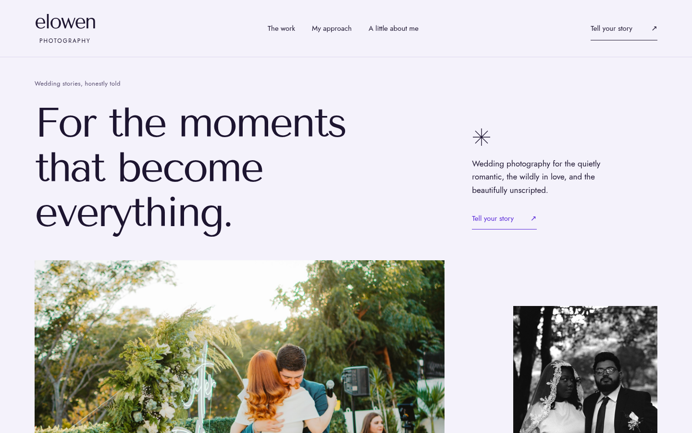
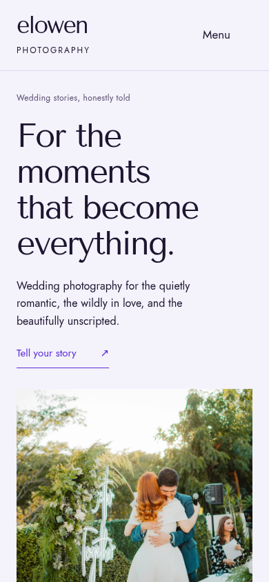
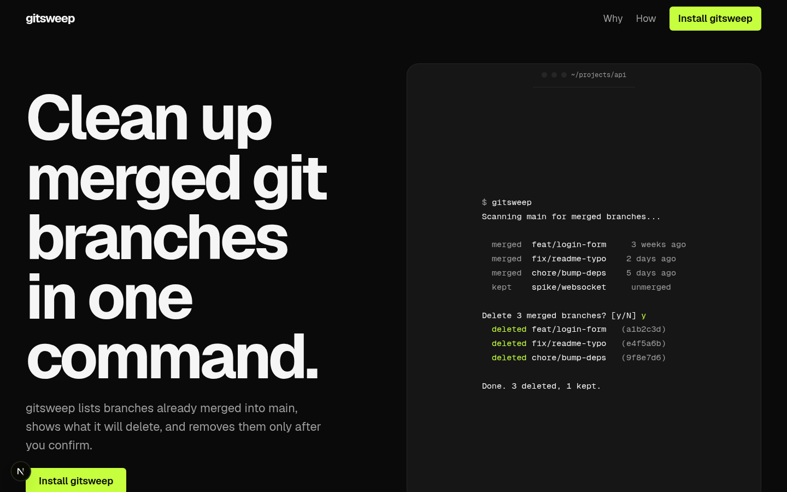
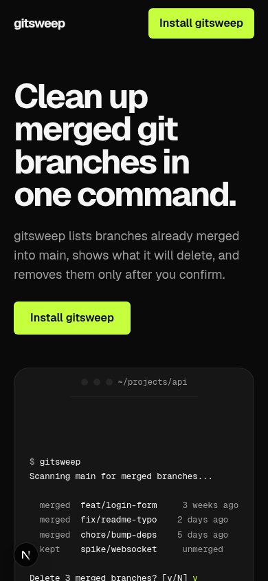

# Evals

Each case is a deliberately short prompt in `evals/cases.json`. `node scripts/eval.mjs --case <id>` runs it through a real agent CLI in a fresh folder, scores the result with `check.mjs`, and sends the FAIL list back into the same session up to three times. A case passes when the gate passes and the agent followed its deal. The screenshots are part of the result: the check measures defects, not taste.

## 2026-11-13: cafe-bucaramanga, DeepSeek V4.1 Flash in OpenCode 2.2.7

Prompt: `haz una landing page para una cafetería en Bucaramanga` (nothing else).

The same model, prompt and harness had produced, with frontend-craft v1, a single HTML file with a cream background, a serif headline with one italic red word, tracked mono labels, almost no motion, and a "done" report.

With v2:

| | Result |
|---|---|
| Followed the skill | Ran `start.mjs`, built with the kit, ran `check.mjs`, fixed what it reported (rendered SVG text under 12 px) and re-ran it before stopping |
| Stack chosen | Vite 8 + React + TypeScript, typecheck and build clean |
| Dealt direction | palette `clay-plum`, type `bricolage-hanken`, composition `place-coordinates`, signature `scramble` with `mask` and `scrub` |
| Followed the deal | Yes: dealt fonts and colors, coordinates and a drawn route on the first screen, hours and address as a ledger |
| Motion measured | 7 elements animate in on load; 10 scroll-linked (the route draws itself with `var(--p)`); 8 reveals |
| Gate | `RESULT: PASS` in the first round, 1 WARN (`nojs-empty`: client-only render) |
| Copy | Spanish, local and specific: "Caldo de costilla, arepa de maíz pelao, huevos pericos y tinto"; actions "Reservar mesa", "Ver la carta" |

<p>
  
  
</p>

Human review of the screenshots: coherent, readable, specific and clearly not the generated default. Weaker points the check cannot judge: the map is a plain grid of blocks rather than a finished illustration, and there is a large empty band under the menu. The visual ambition is "competent editorial", not exceptional; better first-screen artwork (for example through `svg-craft`) is the next lever.

### What the run exposed in the skill (fixed the same day)

- The agent created the project in `~/work/` instead of the session folder. The skill and the OpenCode agent now say: a new project goes in a new folder inside the current working directory.
- The check under-counted motion: its change threshold was in pixels, so `--p` (0 to 1) and scale changes were invisible, and a sticky nav counted as a pinned scene. Thresholds now depend on magnitude, and a pinned scene must hold a stage at least half a screen tall. The first recorded score (0 scroll-linked) was re-measured with the fixed check (10 scroll-linked).
- A pinned motion signature outside the dealt composition's list was silently replaced. Pins now always win.

### Cost note

With this machine's OpenCode configuration every turn carries about 147,000 input tokens of tools and instructions before the task. Standalone runs do not record their usage in the shared session store, so the exact total for this case was not captured.

## 2026-11-13: photographer-html, Codex CLI (ChatGPT login)

Prompt: `portfolio site for a wedding photographer, just html css js`. Command: `codex exec -s workspace-write --json`. No plugin, no hook: Codex found the skills in `~/.agents/skills`.

| | Result |
|---|---|
| Followed the skill | Ran `start.mjs`, built from the blueprint, passed the gate in the first round; also wrote its own logic and browser tests |
| Dealt direction | palette `ink-violet-paper`, type `tenor-jost`, composition `editorial-spread`, signature `mask` |
| Motion measured | 6 elements animate in, 15 reveals, scroll-lit words |
| Media | Three Unsplash photographs downloaded into `assets/` with a `SOURCES.txt` (photographer, URL, license) and marked as samples, not hotlinked. The skill now names this as an allowed route |
| Gate | `RESULT: PASS`, 0 WARN |

<p>
  
  
</p>

## 2026-11-13: sushi-svelte, Gemini CLI

Not run: Gemini CLI 0.42 stopped at authentication with "Resource has been exhausted (e.g. check quota)". Gemini CLI does discover the skills (`gemini skills list` shows all five).

## 2026-11-13: devtool-next, Haiku in Claude Code with the repo loaded as a plugin

Prompt: `landing page for a CLI tool that cleans up git branches, in Next.js`. Command: `claude -p --plugin-dir <repo> --model haiku`, the host's other skills and hooks still active.

| | Result |
|---|---|
| Followed the skill | The plugin's prompt hook pointed it at the run; it ran `start.mjs`, built from the blueprint and passed the gate in the first round |
| Dealt direction | palette `acid-lime-black`, type `geist-solo`, composition `split-stage`, signature `stack` |
| Motion measured | 13 elements animate in, 29 scroll-linked, 8 reveals, stacked chapters and a sticky stage |
| Gate | `RESULT: PASS`, 0 WARN |

<p>
  
  
</p>

Compared with the same model and prompt without the plugin (a stock dark dev-tool template), the headline has scale and the page has a scroll story. Two defects the check did not catch at the time: the hero's action sat below the fold at 1440x900 (the check now fails it as `fold-action-1440`), and the stacked cards showed mostly empty surface on arrival (the chapter layout now puts the heading at the top). Three blueprints failed the new fold rule and were tightened.

## 2026-11-13: what the other runs taught (and why they are not passes)

| Run | Harness and model | Outcome | Cause found | Fixed by |
|---|---|---|---|---|
| festival-vue #1 | OpenCode, GLM-5.3 Flash (free) | Built; user judged it "horrible": thin colonial serif on a gig-poster blue, half the first screen empty, a card cut off at the edge | The deal matched type and palette to the brief separately, never to each other; compositions were one sentence each | Type must share a mood with the palette; every composition ships a working blueprint |
| devtool-next #1 | Claude Code, Haiku | Gate passed, but no deal: a dark take on the default look (one lime italic word in a serif headline, tracked mono labels) | `start.mjs` called through the symlinked install exited silently; seven design skills loaded at once competed | Scripts run through symlinks (tests); the check fails italic accent words on any palette; eval passes now require a followed deal |
| festival-vue #2 | OpenCode, GLM-5.3 Flash (free) | Ran `start.mjs`, then ignored the deal; `deal-font` and `deal-palette` failed and it stopped there | The eval runner gave the agent the wrong working directory (inherited `PWD`), so the follow-up loop never found the project | Runner sets `PWD` with `cwd` |
| festival-vue #3 | OpenCode, GLM-5.3 Flash (free) | Nothing built | Free usage limit reached | Not a skill issue |
| devtool-next #2 | Claude Code, Haiku | Did not load frontend-craft at first (picked a Next.js skill). The gate loop then worked: 4 FAIL, 5 FAIL, 0 FAIL over three rounds, using the kit via `--kit-only`. Without a deal the page is the stock dark dev-tool template | Skill selection is the model's call; a host router added competing suggestions | Plugin `UserPromptSubmit` hook that points web-page prompts at the run |

| festival-vue #4 | pi 1.3.0, OmniRoute `auto/coding:free` | Read `SKILL.md`, skipped `start.mjs`, wrote the page from its defaults; follow-ups made no progress | The free router sends turns to small models (Mistral 7B) or ones that reject the context (`413 Request too large`); it cannot carry a multi-step build | The run now opens with the start command and the check fails `no-direction` without a deal, so any agent that does follow up is told why |
| festival-vue #5 | pi 1.3.0, self-hosted Qwen3.8-27B | Not run: the model server was down (HTTP 530 from its tunnel) | Infrastructure | — |

The OpenCode gate plugin was also rewritten for OpenCode's plugin API v2 after finding it did not load in 2.2.7.

All fourteen blueprints render through the check with sample text (`npm run test:blueprints`): every one passes with an entrance and a scroll-linked scene.

## Running more

```sh
node scripts/eval.mjs --case festival-vue
node scripts/eval.mjs --all --model <provider/model>
node scripts/eval.mjs --case sushi-svelte --agent-cmd "opencode run --standalone --agent frontend --auto --format json"
```

Results are written to `evals/results/<date>-<case>.json` with the deal, the FAIL and WARN ids per round, the motion counts and the screenshot paths.
